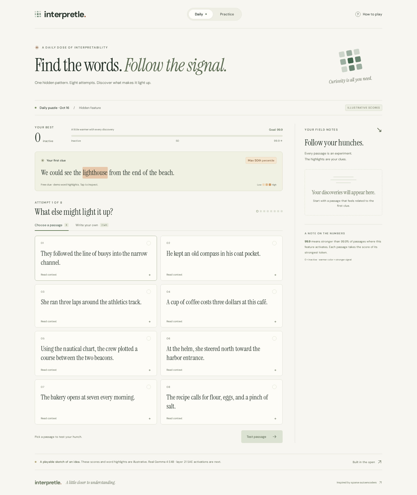

# Interpretle

**Find the words. Follow the signal.**

A Wordle-inspired interpretability game at **[interpretle.com](https://interpretle.com)**. Start with a highlighted passage, form a theory about a hidden feature, and find text that reaches the 99.9th percentile of activation.

**Status: live playable prototype.** All current scores and word highlights are illustrative. Suggested passages have hand-authored scores; custom sentences use a toy keyword rule. Real corpus activations and a Gemma WebGPU export are not connected yet. This distinction is also visible in the game.



[Mobile preview](docs/screenshots/mobile.png)

## Play locally

Use Node 24 or newer (`.nvmrc` selects 24).

```sh
npm ci
npm run dev
```

Open the local URL Vite prints. For a production build, run `npm run build` and then `npm run preview`.

## The game so far

- A shared daily puzzle, changing at midnight UTC, plus a separate practice mode.
- A free starter passage whose strongest highlighted word scores at the 50th percentile.
- Eight attempts. Each round offers eight passages with scores hidden until played.
- Expandable context that does not use an attempt.
- Highlighted words and the passage maximum revealed after every guess. Click a word for its illustrative activation and percentile.
- Up to two custom sentences, each using one of the eight attempts.
- Adaptive passage sampling based on the player's best score; the starter is a clue and does not advance that score.
- A win at an **unrounded** score of at least 99.9. Feature explanation on either a win or loss, and a spoiler-free share result.
- Local progress persistence, mobile layout, keyboard access, and a reduced-motion mode.

The demo has three authored themes. Practice reshuffles these themes; it is not an unlimited library of measured features. Scores and answers are in the browser bundle, so this version makes no anti-cheating claim. Browser-local limits are for playtesting, not production abuse protection.

## Agreed direction

The intended first measured target is **Gemma 4 E4B, layer 21**, using Decode Research's SAE release. Daily puzzles will use curated, interpretable SAE features. Practice can include experimental features and individual neurons. The passage pool should mix chat, prose, code, and technical text.

Scores rank the maximum activation in a passage **among activating reference passages**; genuinely inactive passages show zero. Extract activations with full source context, but show and score only the displayed passage. The corpus and score reference must be frozen per feature. [Game design](docs/game-design.md) records the current rules and unresolved choices. [Scoring plan](docs/scoring.md) records the exact checkpoint metadata, calibration convention, data requirements, and production boundary.

## Checks

```sh
npm run check
npx playwright install chromium
npm run test:e2e
npm run deploy:check
```

The unit suite exercises the sampler, budget limits, win/loss conditions, heatmap maxima, save replay, and percentile calibration. Playwright checks desktop and mobile play, persistence, custom limits, UTC rollover, sharing, and automated accessibility. `deploy:check` builds and validates the static Cloudflare deployment locally without deploying it.

## Cloudflare

`wrangler.jsonc` deploys this app with **Cloudflare Workers Static Assets**. The prototype needs no application server or GPU at runtime. Fonts are bundled locally and custom text stays in the browser.

To publish an update, authenticate the intended Cloudflare account, run `npm run build`, then `npx wrangler deploy`. The configuration attaches `interpretle.com` as a Worker custom domain in that account. Deployments are manual; GitHub Actions runs checks only. See [deployment notes](docs/deployment.md).

**The entire backend is static file hosting.** Run the selected corpus through the model/SAE offline, then publish stored token activations as puzzle data. Support both SAE features and neuron/activation coordinates in those artifacts. The browser samples rounds and stores progress. The measured version will run custom guesses locally through WebGPU; the current demo uses the labeled toy scorer. No server inference, scoring API, database, queue, account system, or server-side sessions. See [the small architecture](docs/architecture.md).

## Repository map

| Path                                        | Purpose                                                         |
| ------------------------------------------- | --------------------------------------------------------------- |
| `src/App.tsx`, `src/components/Heatmap.tsx` | Game interface and inspectable highlights                       |
| `src/lib/game.ts`                           | Deterministic rounds, attempts, persistence, toy custom scoring |
| `src/lib/scoring.ts`                        | Positive-passage empirical percentile calculation               |
| `src/data/demo.ts`                          | Original demo passages and illustrative scores                  |
| `data/model-target.json`                    | Pinned model and SAE metadata; explicitly unscored              |
| `docs/`                                     | Design decisions, production scoring contract, deployment notes |

Code and original demo text are MIT-licensed. Model weights, SAE weights, future datasets, and bundled font packages keep their own licenses. No external dataset excerpts or model weights are included.
